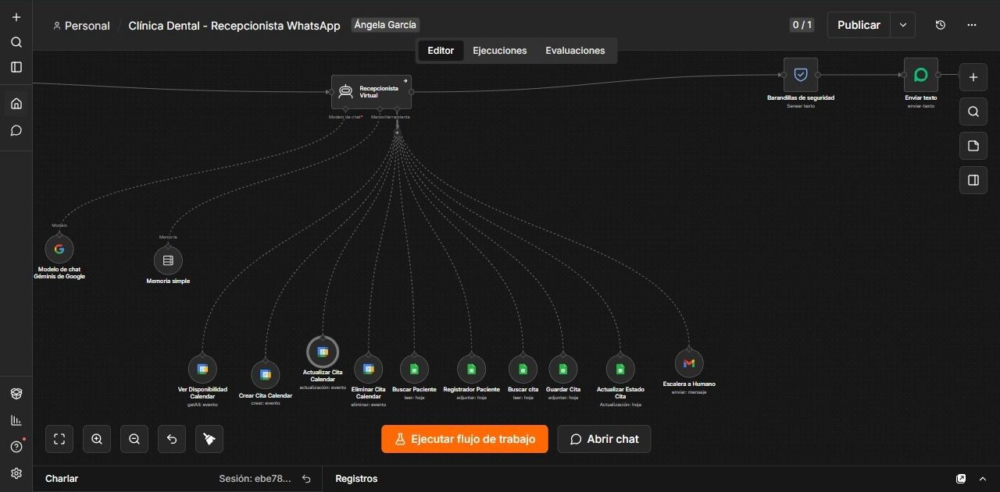
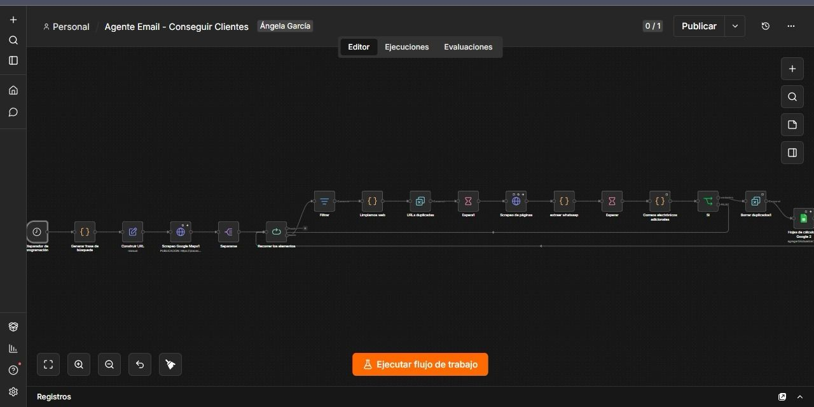

# Angely García
### Automatización de procesos · n8n · APIs REST · Inteligencia artificial

Desarrollo automatizaciones para conectar herramientas, organizar información y simplificar tareas de atención y gestión comercial.

Soy estudiante de Ingeniería Biomédica en la Universidad Tecnológica de Bolívar. Mi experiencia práctica combina flujos con n8n, integración de APIs, transformación de datos y agentes conversacionales con IA.

[LinkedIn](https://www.linkedin.com/in/angely-garcia-190330216/) · [GitHub](https://github.com/Angelygarcia-code)

## Proyectos destacados

| Proyecto | Problema que aborda | Solución | Caso de estudio |
|---|---|---|---|
| Recepcionista con IA por WhatsApp | Consultas y citas repartidas entre el chat, la agenda y registros manuales | Asistente conectado con Calendar y Sheets | [Ver proyecto](proyectos/recepcionista.md) |
| Prospección automatizada de negocios | Búsqueda y recopilación repetitiva de información comercial | Flujo de consulta, extracción y organización en Sheets | [Ver proyecto](proyectos/prospeccion.md) |

### Recepcionista con IA por WhatsApp

Integración de WhatsApp, Gemini y Google Workspace para atender consultas y gestionar información de agendamiento.

[Consultar problema, solución y conversación →](proyectos/recepcionista.md)

### Prospección automatizada de negocios

Búsqueda por ciudad y sector, consulta de sitios web y organización de información pública de contacto.

[Consultar problema, solución y funcionamiento →](proyectos/prospeccion.md)

## Habilidades aplicadas

- Automatización de procesos con n8n: filtros, bucles, condiciones y transformaciones.
- Integración de APIs REST, webhooks y servicios de Google Workspace.
- Procesamiento de datos con JavaScript y JSON.
- Configuración de agentes conversacionales con Gemini y herramientas externas.
- Organización de información comercial en Google Sheets.

## Sobre este portafolio

Selección de proyectos independientes documentados mediante casos de estudio y capturas de funcionamiento. Los archivos ejecutables y las configuraciones internas se conservan en privado.

## Contacto

Interesada en oportunidades como Automation Specialist Jr. y desarrolladora de automatizaciones.

[Contactarme por LinkedIn](https://www.linkedin.com/in/angely-garcia-190330216/)

© 2026 Angely García. Todos los derechos reservados.
