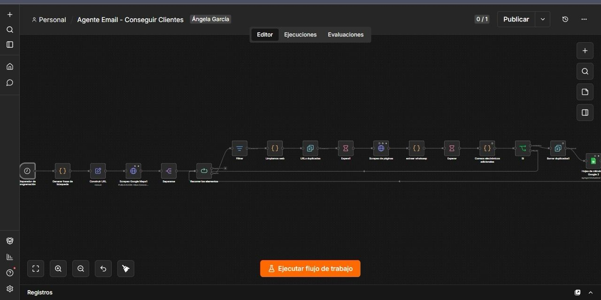

# Prospección automatizada de negocios

[← Volver al portafolio](../README.md)

**Área:** operaciones comerciales · **Tipo:** proyecto independiente

## El problema

La búsqueda manual de prospectos exige repetir un mismo proceso: localizar negocios por ciudad y sector, abrir sus páginas web, buscar contactos y copiar los datos a una hoja de cálculo. La información puede quedar dispersa o repetida, dificultando su revisión posterior.

## La solución

Desarrollé un flujo en n8n que conecta la búsqueda de negocios con la consulta de sus sitios web y la organización de información pública en Google Sheets. El sistema utiliza solicitudes HTTP y transformaciones con JavaScript para procesar los resultados.

## Mi contribución

- Configuración de búsquedas por sector y ciudad.
- Integración con Google Places mediante solicitudes HTTP.
- Normalización de URLs y configuración de deduplicación.
- Extracción de posibles correos y teléfonos desde páginas web.
- Mapeo de datos para su almacenamiento en Google Sheets.

## Funcionamiento

1. Generar una búsqueda a partir de ciudad y sector.
2. Consultar negocios y obtener sus sitios web disponibles.
3. Recorrer resultados, normalizar URLs y aplicar deduplicación.
4. Consultar las páginas y extraer posibles datos de contacto.
5. Organizar los registros por negocio, web, correo, teléfono y ciudad.

La disponibilidad de cada dato depende de la información publicada en el sitio consultado.

## Tecnologías

| Herramienta | Función en el proyecto |
|---|---|
| n8n | Programación y orquestación de las tareas |
| Google Places API | Consulta de negocios |
| HTTP Requests | Consulta de servicios y páginas web |
| JavaScript | Transformación y extracción de datos |
| Google Sheets | Organización de los registros |
| JSON | Intercambio de información entre nodos |

## Vista general del flujo

## Resultado del proyecto

El flujo reúne las etapas de búsqueda, consulta y organización en una misma automatización. Los registros obtenidos se estructuran en Google Sheets para facilitar su revisión comercial.

La evidencia disponible incluye una hoja con sitios web, correos y teléfonos recopilados. Esa captura se conserva en privado porque contiene contactos de terceros.

## Valor del proyecto

Aborda una tarea comercial repetitiva conectando fuentes externas con un registro central. Demuestra uso de APIs, recorrido de resultados, transformación de datos y escritura estructurada en una herramienta de trabajo.

Los archivos ejecutables y el código de extracción se mantienen privados.
