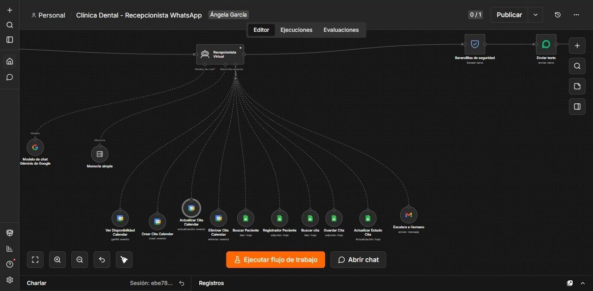
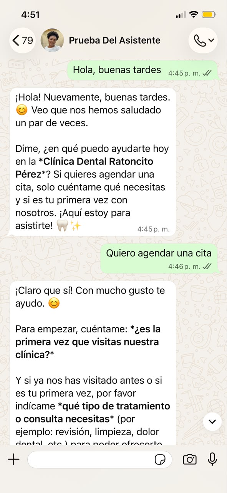
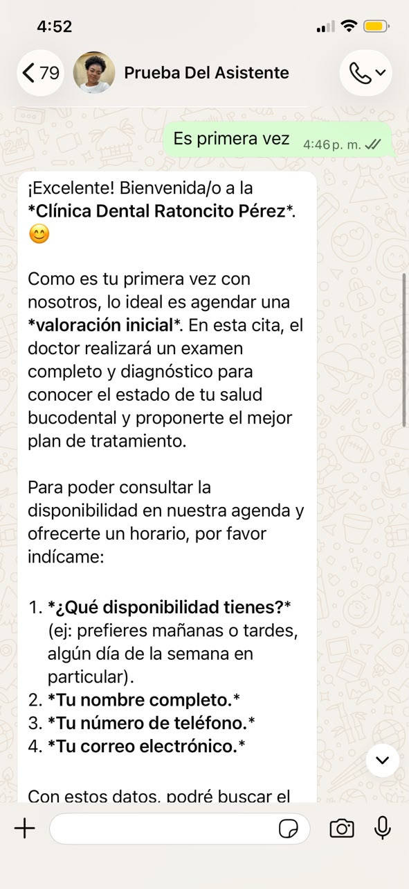

# Recepcionista con IA por WhatsApp

[← Volver al portafolio](../README.md)

**Área:** atención y gestión de citas · **Tipo:** proyecto independiente

## El problema

Cuando la atención de una clínica se gestiona manualmente por WhatsApp, cada consulta puede exigir revisar la agenda, pedir datos al paciente y copiar información entre herramientas. Esa fragmentación aumenta las tareas administrativas y dificulta mantener un registro organizado.

## La solución

Desarrollé un asistente conversacional para recepción odontológica que conecta WhatsApp con un agente de IA y herramientas de Google Workspace. El proyecto reúne la conversación, la consulta de agenda y el registro de información en un flujo de n8n.

## Mi contribución

- Configuración del flujo en n8n y de su conexión con Evolution API.
- Definición de instrucciones del asistente para consultas y solicitudes de cita.
- Preparación de datos del mensaje mediante JavaScript.
- Integración de herramientas de Google Calendar y Google Sheets.
- Configuración de memoria de conversación por sesión.

## Recorrido de agendamiento

1. El usuario inicia una conversación en WhatsApp.
2. El asistente identifica si desea una cita y si es su primera visita.
3. Recoge preferencias y datos necesarios para el agendamiento.
4. Utiliza las herramientas de agenda y registro dentro del flujo.
5. Continúa la conversación para orientar al usuario.

## Tecnologías

| Herramienta | Función en el proyecto |
|---|---|
| n8n | Orquestación del flujo y conexión entre servicios |
| Evolution API | Recepción y envío de mensajes de WhatsApp |
| Gemini | Interpretación de la solicitud y generación de respuestas |
| Google Calendar | Herramientas de consulta y gestión de agenda |
| Google Sheets | Registro y consulta de información de pacientes y citas |
| JavaScript y webhooks | Preparación de datos y entrada de eventos |

## Vista general del flujo

## Evidencia visual

Las capturas muestran una conversación en la que el asistente identifica una solicitud de cita, distingue una primera visita y solicita disponibilidad e información de registro.

## Valor del proyecto

El diseño reúne tareas de recepción en una misma conversación y conecta la atención con herramientas que permiten organizar la agenda y los registros. Demuestra integración de servicios, gestión del contexto y uso de herramientas por un agente de IA.

La documentación pública presenta el caso de uso y su implementación general; los archivos de ejecución se mantienen privados.
